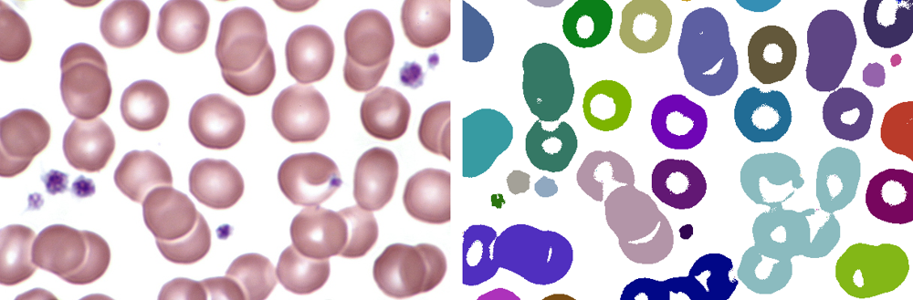

# CellCounterCL

Counts cells in blood smear images on the GPU with OpenCL. Dark pixels are cell pixels, and every group of touching cell pixels is one cell. The groups are found with a lock-free parallel union-find.



*Left: input image. Right: every detected cell in its own color (54 cells).*

## How it works

1. **Mask** (`image_to_mask_matrix` kernel, one work-item per pixel): a pixel is part of a cell if its brightness, the mean of its RGB values, is below the threshold (200 by default). Cell pixels get their own index, background pixels get -1.
2. **Union-find** (`merge_cells` kernel, one work-item per pixel): each cell pixel merges its set with the sets of its 8 neighbours, so diagonal pixels belong to the same cell.
   - Roots are linked with `atomic_cmpxchg`, always the larger index under the smaller one. Parents only point to smaller indices, so racing unions can never create a cycle.
   - `find` uses path splitting to keep the trees shallow.
   - Only OpenCL 1.1 atomics are used, so the kernel also runs on OpenCL 1.2 devices such as Apple GPUs.
3. **Labels** (numpy): every pixel is pointed straight to its root by pointer jumping, then the roots are numbered 0 to n-1.

The result is checked against a sequential flood fill in the tests.

## Results

Apple M5 GPU, threshold 200, time for the mask, the union-find and the labelling:

| Image | Size | Cells | Time |
| --- | --- | --- | --- |
| Anisocytose_plaquettaire | 600×400 | 54 | 0.016 s |
| Plaquettes_normales | 600×400 | 71 | 0.012 s |
| Plaquette_geante | 400×267 | 31 | 0.006 s |
| Neutrophils_monocyte | 858×858 | 199 | 0.039 s |
| Eosinophil_blood_smear | 1584×1443 | 1567 | 0.108 s |
| Patology_of_platelet | 2464×2056 | 27787 | 0.160 s |
| Platelets2 | 2560×1920 | 4411 | 0.203 s |
| Thrombocytosis | 2560×2048 | 3730 | 0.178 s |

For comparison, the sequential flood fill in Python takes 5 to 8 seconds on the largest images.

## Installation

Requirements: Python 3.10+ and an OpenCL device.

```sh
python3 -m venv venv
source venv/bin/activate
pip install -r requirements.txt
```

macOS ships with an OpenCL driver. On Linux without a GPU driver, install the [pocl](https://portablecl.org/) CPU backend with `pip install "pyopencl[pocl]"` (x86_64 only).

## Usage

```sh
python main.py                        # every image in images/
python main.py images/Platelets2.jpg  # specific images
```

| Option | Default | |
| --- | --- | --- |
| `--threshold N` | `200` | a pixel is part of a cell if its brightness (0-255) is below `N` |
| `--workgroup auto\|driver` | `auto` | `auto` computes a square work-group size for GPUs, `driver` lets OpenCL choose |
| `--output DIR` | `results/` | where the highlighted images are saved |

With several OpenCL devices, pick one with the `PYOPENCL_CTX` environment variable (for example `PYOPENCL_CTX=0:1`).

```
Device: Apple M5
Threshold: 200

Image: Anisocytose_plaquettaire (600x400)
Cell count: 54
Execution time: 0.0164s
...
```

## Tests

```sh
pip install -r requirements-dev.txt
pytest
```

The tests run on the available OpenCL device, with both work-group modes:
- small hand-drawn images (no cells, one cell, diagonal connections, separate cells, threshold),
- the union-find gives exactly the same cells as the flood fill on the small sample images, over several runs to catch races.

## Limitations

- Cells that touch are counted as one cell (see the right image above). Separating them would need something like a watershed.
- The brightness threshold is global, so uneven lighting or staining changes the result.

## Project structure

```
.
├── main.py                  # host code: OpenCL setup, labelling, command line
├── main.cl                  # OpenCL kernels: mask and union-find
├── tests/                   # pytest tests
├── images/                  # sample images
└── docs/example.png
```

## Image credits

All sample images come from [Wikimedia Commons](https://commons.wikimedia.org/wiki/Category:Platelets) (some were renamed):

| File | Author | License |
| --- | --- | --- |
| [Anisocytose_plaquettaire.jpg](https://commons.wikimedia.org/wiki/File:Anisocytose_plaquettaire.JPG) | Guy Waterval | Apache License 2.0 |
| [Eosinophil_blood_smear.jpg](https://commons.wikimedia.org/wiki/File:Eosinophil_blood_smear.JPG) | Bobjgalindo | CC BY-SA 4.0 |
| [Neutrophils_monocyte_16694967012.jpg](https://commons.wikimedia.org/wiki/File:Neutrophils_%2B_monocyte_(16694967012).jpg) | Hanna Sörensson | CC BY-SA 2.0 |
| [Patology_of_platelet.jpg](https://commons.wikimedia.org/wiki/File:Patology_of_platelet.jpg) | Animalculist | CC BY-SA 4.0 |
| [Plaquette_geante.jpg](https://commons.wikimedia.org/wiki/File:Plaquette_g%C3%A9ante-1.JPG) | Guy Waterval | Apache License 2.0 |
| [Plaquettes_normales.jpg](https://commons.wikimedia.org/wiki/File:Plaquettes_normales-1.JPG) | Guy Waterval | Apache License 2.0 |
| [Platelets2.jpg](https://commons.wikimedia.org/wiki/File:Platelets2.JPG) | Dr Graham Beards | CC BY-SA 4.0 |
| [Thrombocytosis.jpg](https://commons.wikimedia.org/wiki/File:Thrombocytosis.jpg) | Erhabor Osaro | CC BY-SA 3.0 |

`docs/example.png` is derived from Anisocytose_plaquettaire.jpg (Guy Waterval, Apache License 2.0). `tiny-example.bmp` is a 10×6 test image.
